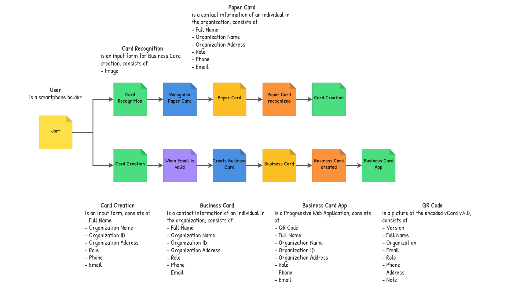

# Firmcard

Turn your paper business card into an installable app.

1. Take a photo of your paper card.
2. Check the details it read and correct any mistakes.
3. Install your card and share it by QR, even offline.
4. Scan cards other people give you to save their contacts.

Domain spec: [specs.md](specs.md). Agent instructions: [AGENTS.md](AGENTS.md).

## Implementation tradeoffs

- **One generated PWA per card**, with the card data baked into its files. Works fully offline; editing a card means reinstalling.
- **Generated files are the storage** (`data/` volume). No database, but a single instance only.
- **Card URLs use random IDs.** Unguessable, but anyone with the link can open the card.
- **Cards are kept forever and can't be deleted or corrected.** They hold personal data, so EU users (GDPR) may need a deletion path and a retention limit.
- **No privacy notice or imprint (Impressum).** The site processes photos and contact data; operating from Germany also requires an imprint page.
- **Hand-written service worker**, since card apps are generated at runtime.
- **QR code holds a vCard 4.0**, not a link, so sharing works offline. iOS may handle 4.0 worse than 3.0; long fields make the QR code denser.
- **Scanning uses the phone's camera app.** No in-app scanner, and Firmcard never sees scanned contacts.
- **OCR runs on the server** (Tesseract.js) and photos are never stored. Needs network; users must review every field.
- **OCR reads English and Bulgarian.** Language data is bundled in the Docker image, pinned by checksum. Without `tessdata/`, as in local development, it is downloaded once to `data/tesseract/`.
- **Photos are resized in the browser** (2000 px JPEG) **and cleaned up on the server** (orientation, grayscale, contrast, sharpening, lighting correction). No perspective correction.
- **Several OCR passes per photo** (with and without lighting correction, then rotated 90° and 270° if still unreadable); the most confident one wins. Hard photos take up to about 15 seconds.
- **Field detection uses English keyword lists** for roles, companies, and addresses. Email, phone, and name detection work in any language.
- **Phone numbers are validated per country** (libphonenumber-js). Without a country code, hints come from postcodes (`LV-1010`) and domains; otherwise the raw number is kept.
- **The name is the largest name-like line.** `SMITH John` becomes `John Smith`.
- **`createBusinessCard` also returns `appUrl`**, one field beyond `specs.md`.
- **Images are sent as base64 data URLs** (JPEG, PNG, or WebP, up to 5 MB). Plain JSON-RPC, about a third larger.
- **Events are not persisted.** `version` resets on restart.
- **No branding.** The site uses the default Next.js favicon and has no social share image.
