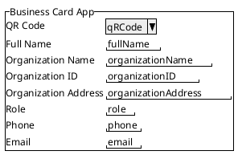
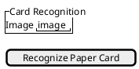
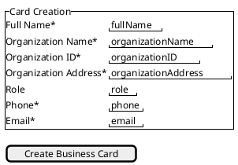
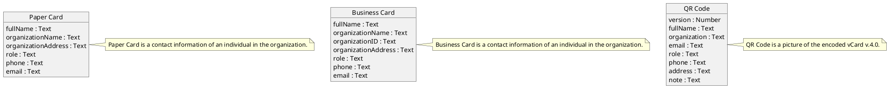

# Domain Specification: complete

Version: recent

## Actors

User is a smartphone holder.

## User Interface

Paste into the [PlantUML Web Editor](https://editor.plantuml.com/) to explore.

### Business Card App

Business Card App is a Progressive Web Application.



### Card Recognition

Card Recognition is an input form for Business Card creation.
Used by User.



### Card Creation

Card Creation is an input form.
Used by User.



## Application Programming Interface

Paste into the [OpenRPC Playground](https://playground.open-rpc.org/) to explore and call it interactively.

```json
{
  "openrpc": "1.2.6",
  "info": {
    "title": "complete API",
    "version": "recent"
  },
  "methods": [
    {
      "name": "complete.createBusinessCard",
      "summary": "Create Business Card",
      "params": [
        {
          "name": "cardCreation",
          "schema": {
            "type": "object",
            "properties": {
              "fullName": {
                "type": "string"
              },
              "organizationName": {
                "type": "string"
              },
              "organizationID": {
                "type": "string"
              },
              "organizationAddress": {
                "type": "string"
              },
              "role": {
                "type": "string"
              },
              "phone": {
                "type": "string"
              },
              "email": {
                "type": "string"
              }
            },
            "required": [
              "fullName",
              "organizationName",
              "organizationID",
              "organizationAddress",
              "phone",
              "email"
            ]
          }
        }
      ],
      "result": {
        "name": "result",
        "schema": {
          "type": "object",
          "properties": {
            "businessCard": {
              "$ref": "#/components/schemas/BusinessCard"
            }
          }
        }
      }
    },
    {
      "name": "complete.recognizePaperCard",
      "summary": "Recognize Paper Card",
      "params": [
        {
          "name": "cardRecognition",
          "schema": {
            "type": "object",
            "properties": {
              "image": {
                "type": "string"
              }
            }
          }
        }
      ],
      "result": {
        "name": "result",
        "schema": {
          "type": "object",
          "properties": {
            "paperCard": {
              "type": "object",
              "properties": {
                "fullName": {
                  "type": "string"
                },
                "organizationName": {
                  "type": "string"
                },
                "organizationAddress": {
                  "type": "string"
                },
                "role": {
                  "type": "string"
                },
                "phone": {
                  "type": "string"
                },
                "email": {
                  "type": "string"
                }
              }
            }
          }
        }
      }
    },
    {
      "name": "events",
      "summary": "One SSE event stream per app.",
      "x-sse": true,
      "params": [],
      "result": {
        "name": "event",
        "schema": {
          "$ref": "#/components/schemas/Event"
        }
      }
    }
  ],
  "components": {
    "schemas": {
      "BusinessCard": {
        "type": "object",
        "description": "Business Card is a contact information of an individual in the organization.",
        "properties": {
          "fullName": {
            "type": "string"
          },
          "organizationName": {
            "type": "string"
          },
          "organizationID": {
            "type": "string"
          },
          "organizationAddress": {
            "type": "string"
          },
          "role": {
            "type": "string"
          },
          "phone": {
            "type": "string"
          },
          "email": {
            "type": "string"
          }
        }
      },
      "PaperCard": {
        "type": "object",
        "description": "Paper Card is a contact information of an individual in the organization.",
        "properties": {
          "fullName": {
            "type": "string"
          },
          "organizationName": {
            "type": "string"
          },
          "organizationAddress": {
            "type": "string"
          },
          "role": {
            "type": "string"
          },
          "phone": {
            "type": "string"
          },
          "email": {
            "type": "string"
          }
        }
      },
      "Event": {
        "type": "object",
        "properties": {
          "type": {
            "type": "string",
            "enum": [
              "BusinessCardCreated",
              "PaperCardRecognized"
            ]
          },
          "createdAt": {
            "type": "string"
          },
          "version": {
            "type": "number"
          },
          "payload": {
            "type": "object"
          }
        }
      }
    }
  },
  "externalDocs": {
    "description": "StormPilot",
    "url": "https://stormpilot.codelev.com/edit/cmwbulkjf0007mg8r5gx2s5rl/cmwbxwjux000fmg8rgb3bzawk"
  }
}
```

## Data Model

Paste into the [PlantUML Web Editor](https://editor.plantuml.com/) to explore.



## Behavior

```gherkin
@complete.createBusinessCard
Scenario: When Email is valid
  Given BusinessCard exists
  And BusinessCard email is valid
  When User submits "cardCreation"
  And "createBusinessCard" is executed
  Then "BusinessCardCreated" is emitted

```
